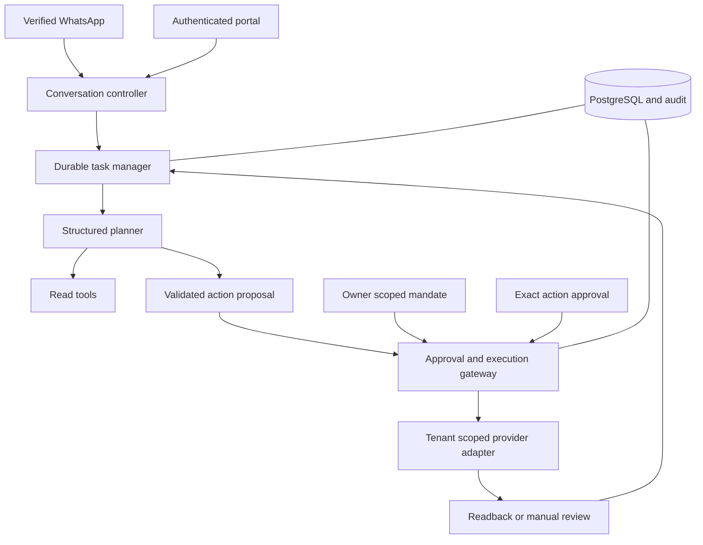

# System architecture

Status: isolated integration, not a production release.

Continue the root Node/Express modular monolith, PostgreSQL source of truth and leased SQL queues. Reuse identity, OAuth, media, task and execution modules. No extra microservices, Kafka, Redis or duplicate CRM.

Tenant identity comes from channel/session authentication, never model text. Existing Meta preparation, approval hashes, connection generations, execution permit and readback remain authoritative. The portal can opt into the same controller and task; default-off flags preserve existing behavior.

The first standing authority supports enumerated non-spending actions. Creation remains paused. Launch/resume/budget changes retain exact separate approval. Expiry, account/resource scope, quotas, reviewed artifacts, leases and revocation apply at execution.

Current tenant is clients.id; this does not implement full organization/brand/branch RBAC. Generated-media storage still uses the existing WhatsApp asset adapter; independent storage is S5 work. Provider eligibility and real pilot acceptance are distinct gates.
